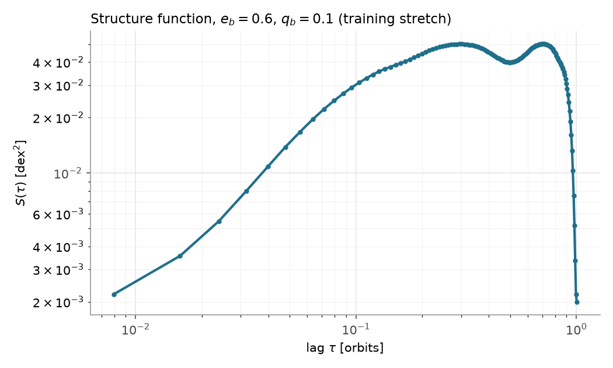
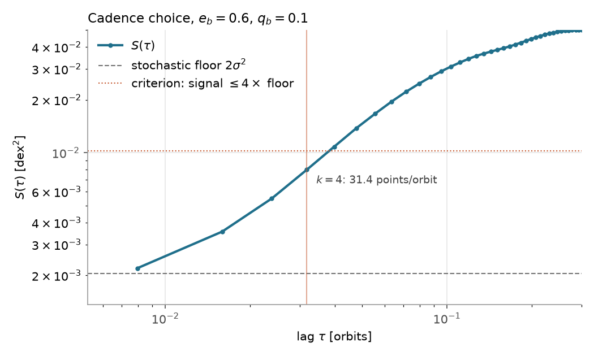
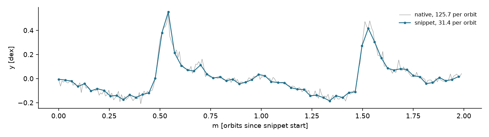
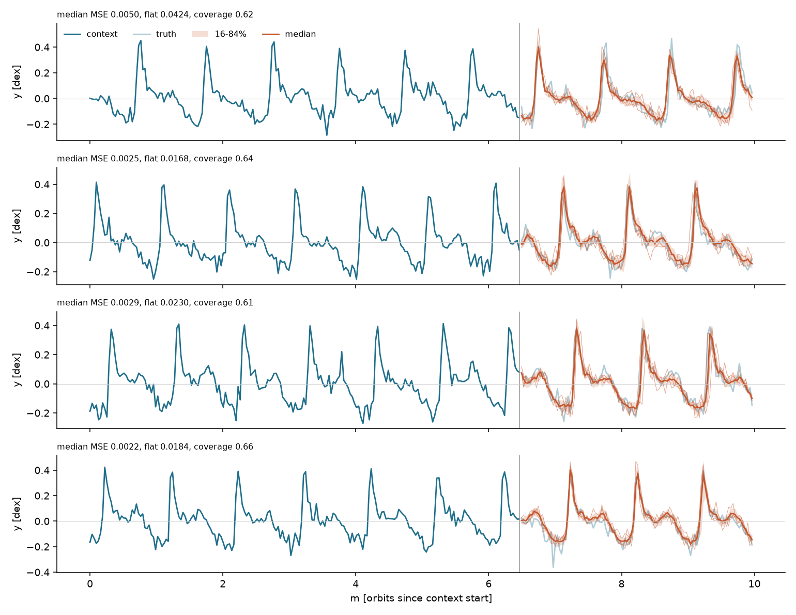
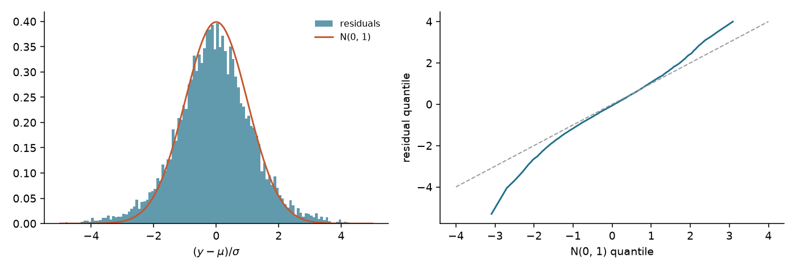

# fates

**Forecasting Autoregressive Transformer for Ensemble Sampling**: probabilistic forecasting of accretion-rate time series from hydrodynamic simulations of binaries in circumbinary discs.

*A forecast on held-out data. Teal: the observed context (the model reads 6.5 orbits; the last 3.5 are shown). Coral: 32 trajectories sampled from the model, one point at a time, and their median. Faint teal behind: what actually happened.*

This page summarises the method and results. The code is private and not included here; it is available on request.

---

## The problem

A binary embedded in a circumbinary disc accretes gas in a pattern that repeats every orbit but never exactly: each burst differs from the last, and the disc carries stochastic variability from orbit to orbit. I ran a suite of hydrodynamic simulations (arepo) across binary eccentricity `e_b` and mass ratio `q_b`. The long-term goal is a single generative model of `p(accretion series | e_b, q_b)` that can forecast a series, infer the binary from a series, and say how far ahead a forecast stays reliable.

Everything below is the first step: one binary (`e_b = 0.6`, `q_b = 0.1`), forecasting only.

## The model

- **Transformer in JAX**: 0.79M parameters, 4 attention blocks, causal attention so each point sees only its past.
- **What it reads.** The modelled quantity is `log10` accretion rate, detrended with one line fitted to the whole series and zero-meaned per training window. Each input token carries the previous value and the sine and cosine of the current orbital phase.
- **Time is continuous.** Positions are the true sample times in orbits, encoded with rotary position embeddings, so attention depends on the time gap between points rather than on their index.
- **Probabilistic output.** A Gaussian head predicts a mean and a spread for the next value, trained on the negative log-likelihood. A forecast is an ensemble: each trajectory draws its next value, feeds it back, and continues.
- **Swappable components.** The output head and the loss are chosen by name in one configuration, which refuses pairs that do not fit together, and every saved model carries its configuration and code version.

Data split in time: training on orbits 0-3500, validation (early stopping) on 3500-4000, all results below on the held-out orbits 4000-5000.

## Model development step-by-step

### 1. Forecast only within the training length

A model trained on windows of up to 5 orbits forecast about 6x worse with 10 orbits of context plus 2 of forecast than with 3 + 2. Forecast points join the sequence the model reads, so **context + horizon must fit inside the training window**. The banner needs 6.5 + 3.5 = 10 orbits, so the model trains on windows of 1, 5 and 10 orbits.

### 2. Choose the sampling cadence from the data

Ten-orbit windows at the native ~126 samples per orbit are expensive on a laptop, but coarsening throws away information. How much can be dropped was settled from the **structure function** `S(tau)`, the mean squared change of the series over a lag `tau`:

At every whole-orbit lag the regular orbital pattern cancels, and what is left is a floor of about 0.002 dex², the same from 1 to 1000 orbits: the accretion's orbit-to-orbit stochasticity, which neighbouring samples cannot predict. Splitting `S` into that floor plus a signal part gives a rule: keep the coarsest spacing at which the signal part stays within 4x the floor.

Result: **every 4th sample, 31.4 points per orbit**. The limit of 4 was chosen so that the answer does not change with how much data is held out (it is the same on any 50-80% training stretch). Samples are dropped, not averaged, because averaging would shrink the stochastic floor, which is physics the model has to reproduce.

Effect on cost: one training step of the multi-step loss on a batch of 5-orbit windows went from 31 s to 1.7 s (measured on the same laptop and model).

### 3. A Gaussian head, trained teacher forced

A point forecast cannot show uncertainty, so the head predicts a mean and a spread. It was trained on one-step-ahead prediction (teacher forcing) rather than on its own rollouts: that is faster, and a one-step point model had already beaten a flat-line baseline on every test case when forecasting within its training length. Training took 100 epochs, about 20-30 minutes on a laptop CPU.

## Results on held-out data

Twenty forecasts from random starts in the held-out stretch, 32 sampled trajectories each. Error is the mean squared error of the median trajectory, in `log10` accretion rate. The baseline holds the last observed value flat.

| context + forecast | median error | flat-line error | beats flat line | 16-84% band coverage (nominal 68%) |
|---|---|---|---|---|
| 3 + 2 orbits | 0.0023 | 0.0331 | 20 / 20 | 59% |
| 6.5 + 3.5 orbits (the banner setting) | 0.0030 | 0.0276 | 20 / 20 | 60% |

**Is the spread honest?** Not entirely, and the evaluation says why. One step ahead, the errors divided by the predicted spread should look like a standard normal. Their standard deviation is 1.22 rather than 1 (the model is about 20% overconfident), and the tails are heavier than a Gaussian allows (excess kurtosis +7): most steps are well predicted, and a few miss by several standard deviations.

So the forecasts track the bursts closely, and the band is somewhat too narrow, because a single Gaussian per step is not flexible enough for this series.

## Next

- A more flexible output distribution (a mixture or diffusion head), and calibration of the band.
- Conditioning on the binary parameters `(e_b, q_b)` across the whole simulation suite, then inferring them from a series.
- A key-value cache, so long forecasts are cheap to generate.

---

© 2026 Magdalena Siwek. All rights reserved. This repository contains no code and is shared for viewing only; the figures and text may not be reused without permission.
